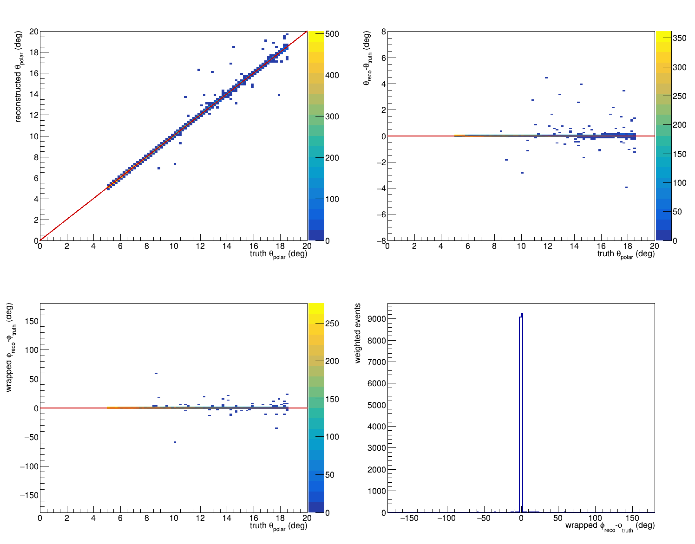
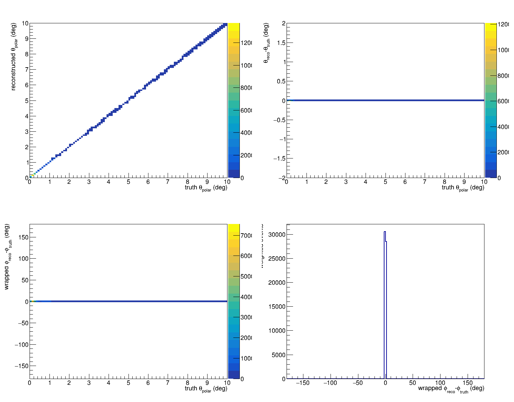
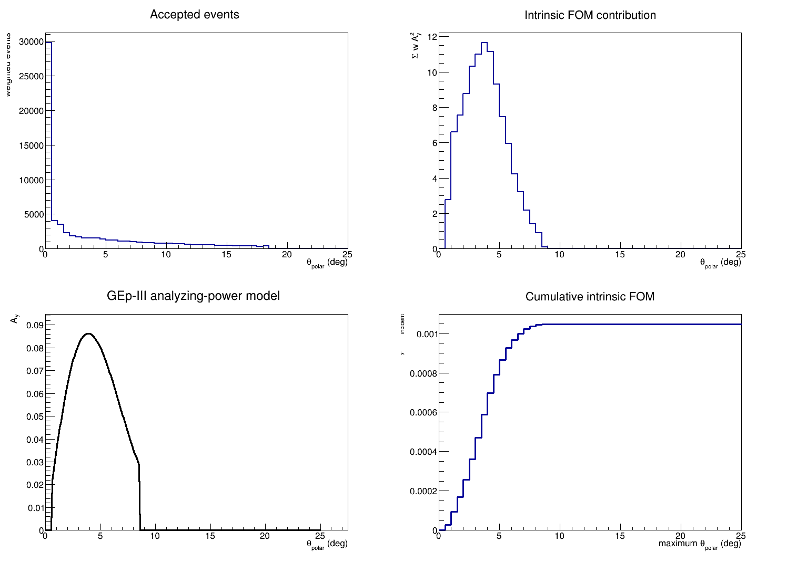
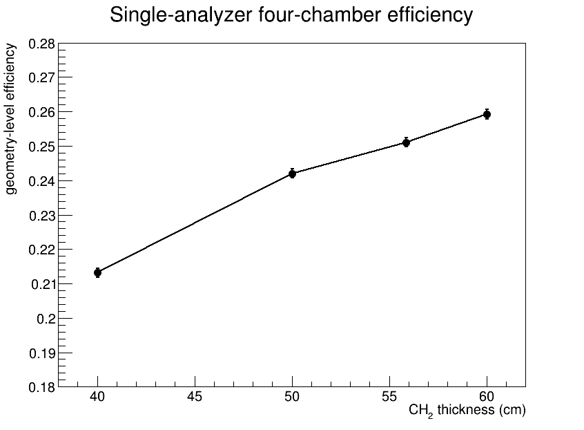
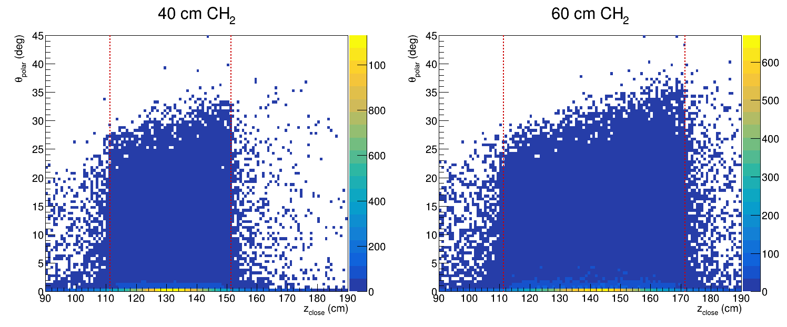
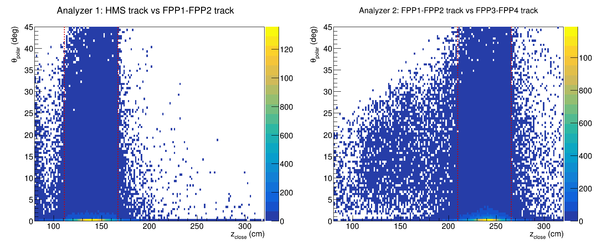
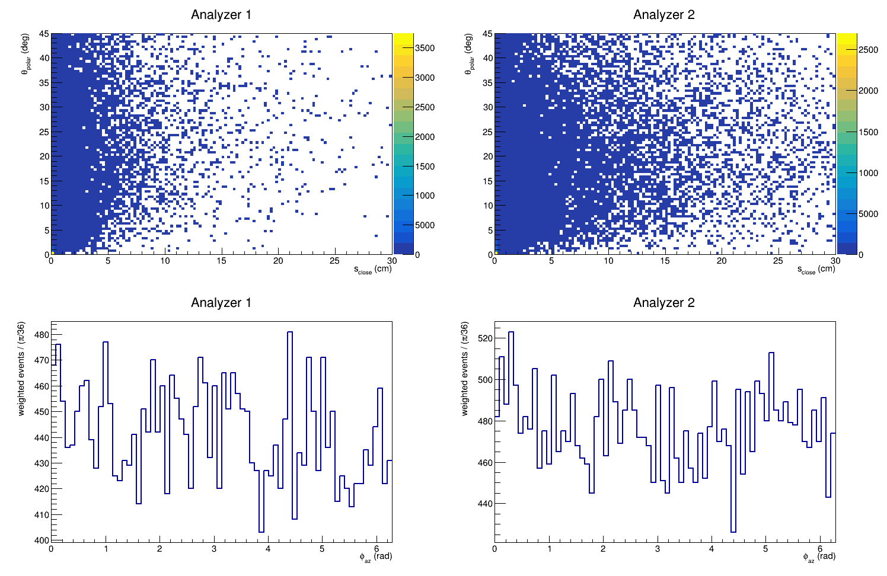

# GEp-4 Hall C FPP GEANT4 simulation

Standalone GEANT4 transport simulation for estimating the Hall C focal-plane
polarimeter efficiency and figure of merit for a possible GEp-4 reboot.

The initial geometry is transcribed from the GEp-III GEANT3 program at:

```text
/work/hallc/gep/brash/e93027/brash/geant_gep
```

This repository intentionally remains separate from SIMC. SIMC supplies
weighted, HMS-accepted proton events at the FPP reference plane; this program
transports them through the downstream scintillators, CH2 analyzers, and
idealized FPP tracking planes.

## Current scope

- GEp-III baseline geometry with two legacy 22-inch (55.88 cm) CH2 analyzers.
- CSV input for weighted proton phase space.
- `FTFP_BERT` hadronic physics by default.
- Idealized FPP tracking planes.
- ROOT ntuple containing incident kinematics, first hadronic interaction,
  scattering angle, outgoing momentum, and per-track chamber-pair acceptance.

The current output is a transport-validation product, not yet a final FOM.
Analyzing power will be applied outside GEANT4 after defining and validating
the useful-scattering selection.

## Input contract

CSV columns are:

```text
event_id,weight,x_cm,y_cm,z_cm,px_GeV,py_GeV,pz_GeV
```

Coordinates refer to the simulation reference frame. The GEp-III baseline
uses the HMS focal plane as `z = 0`; downstream elements retain the positions
encoded in the legacy program.

## Build and run on ifarm

```bash
module load geant4/11.2.1
cmake -S . -B build -DCMAKE_BUILD_TYPE=RelWithDebInfo
cmake --build build -j4
ctest --test-dir build --output-on-failure
```

Run explicitly with:

```bash
./build/gep4_fpp_sim macros/run_example.mac data/example_events.csv output.root
```

An optional fourth argument selects a Geant4 reference physics list, for
example `QGSP_BERT`.

Summarize the weighted geometry-level efficiency for a chosen useful angular
range with:

```bash
python3 analysis/summarize_efficiency.py output.root --theta-min 5 --theta-max 30
```

The reported statistical uncertainty is only a weighted-sample diagnostic.
Hadronic-model, geometry, reconstruction, and analyzing-power uncertainties
must be evaluated separately.

The primary reconstruction diagnostic is the two-dimensional distribution of
polar scattering angle versus the z coordinate of closest approach of the
upstream and downstream tracks:

```bash
python3 analysis/plot_theta_vs_zclose.py output.root theta_vs_zclose
```

The plot marks the physical z boundaries of each CH2 analyzer. This is the
direct analogue of the central GEp-III FPP reconstruction diagnostic.
The same command also writes a companion canvas containing
`theta_polar` versus `s_close` and the accepted-event azimuthal distributions
for both analyzers. The azimuth follows the legacy GEp-III convention:
`atan2(delta horizontal slope, delta vertical slope)`, stored in radians and
wrapped onto `[0, 2 pi)`.

Scan the geometry-level efficiency after requiring `z_close` to lie inside
the corresponding analyzer and varying the `s_close` requirement with:

```bash
python3 analysis/scan_reconstruction_cuts.py output.root \
  --theta-min 5 --theta-max 30
```

The combined efficiency is an event-level union: an event accepted in both
analyzers is counted only once.

## Single-analyzer mode

Use one analyzer and require the scattered charged track to traverse all four
FPP chambers with:

```bash
./build/gep4_fpp_sim run.mac events.csv output.root \
  --single-analyzer --analyzer-thickness-cm 40
```

The single-analyzer truth-efficiency summary applies the historical GEp-III
cone test by default.  For each accepted polar scattering angle, the complete
azimuthal cone from 0 to 2pi must fit within the rectangular active area of
the last required rear chamber.  This makes the truth-level efficiency use
the same azimuthally symmetric acceptance definition intended for the later
wire-level reconstruction study.  Pass `--no-cone-test` to
`analysis/summarize_single_analyzer.py` only when reproducing the earlier
geometry-only numbers.

## Hall C chamber digitization

`FPPGeometry` contains the authoritative twelve-plane Hall C GEp-III chamber
layout from `Analyzer/replay/PARAM/hfpp.param`: four chambers with U/X/V
measurement planes, one-based 104/83/104 wire numbering, 2 cm pitch, and the
measured layer z positions. `digitizeFPPLine` maps a straight truth trajectory
to the nearest legacy wire and its unsigned three-dimensional distance of
closest approach. This is deliberately an analytical digitizer; individual
physical wires are not constructed in GEANT4.

`digitizeFPPTrack` produces the reconstruction-facing hit representation:
plane identity, one-based wire number, and unsigned drift distance only. It
does not retain the truth crossing coordinate or the drift sign. Chamber masks
permit the first six-plane pair, rear six-plane pair, or all twelve planes to
be formed with the same digitizer.

`fitFPPWireCenters` implements the next historical reconstruction stage: a
simultaneous four-parameter straight-line fit to the U/X/V wire centers. It
requires at least five of the six planes in a chamber pair and preserves the
legacy rough-fit chi-squared weighting convention. Drift signs and truth
coordinates are not used in this fit.

`fitFPPLeftRightPermutations` then applies each possible sign combination to
the unsigned drift distances, refits the straight track, and retains the
minimum reduced-chi-squared solution. A normal six-plane chamber pair tries
all 64 permutations. The selected signed drifts remain reconstruction output;
the truth crossing coordinates are not consulted.

The first reconstruction closure output (`front_reco_*`) is truth-associated:
GEANT4 identifies the charged particle that crosses FPP1 and FPP2, but the fit
receives only its six digitized plane IDs, wire numbers, and unsigned drift
distances. `analysis/analyze_two_chamber_reconstruction_closure.py` compares
the resulting reconstructed polar and azimuthal angles with truth. In the
first 100,000-event, 55.88-cm-analyzer sample, all 18,377 truth-selected events
were fit. The polar-angle RMS is 0.009--0.141 degrees across the 5--19 degree
bins; the wrapped azimuthal-angle RMS is 0.040--1.142 degrees. The fraction
with a polar error above 2 degrees or an azimuthal error above 30 degrees is at
most 0.111% or 0.037%, respectively, in any bin. Thus the idealized six-plane
fit does not exhibit a large catastrophic left/right branch population,
including below the proposed 12-degree topology switch. This validates the
digitizer and fitter but is not yet a full multi-track pattern-recognition
efficiency measurement: the hits are truth-associated and presently contain
no chamber inefficiency, resolution smearing, noise, or competing tracks.

[PDF: idealized two-chamber reconstruction closure](plots/single_55p88cm_two_chamber_reco_closure.pdf)



## Small-angle four-chamber closure and first FOM

The single-analyzer configuration also performs a twelve-plane fit using all
four U/X/V chamber triplets.  This is the relevant topology for GEp-4 because
the GEp-III high-energy analyzing-power parameterization uses
`0.07 < pT < 1.0 GeV/c`, corresponding to approximately 0.6--8.6 degrees at
6.7 GeV/c.  The earlier 5-degree lower cut therefore discarded most of the
useful polarimetry.

In the first 100,000-event, 55.88-cm sample, all 59,113 truth-selected events
from 0--10 degrees were fit.  The polar-angle RMS rises from 0.000003 degrees
below 0.5 degrees to 0.0021 degrees in the 7--10 degree bin; no event has a
polar error above 0.5 degrees or an azimuthal error above 30 degrees.  This is
an ideal closure result: hits are truth-associated and have exact drift
distances, with no chamber inefficiency, resolution smearing, noise, or
competing tracks.

[PDF: idealized four-chamber small-angle reconstruction closure](plots/single_55p88cm_four_chamber_reco_closure.pdf)



The first intrinsic FOM calculation uses the GEp-III/SBS parameterization

`Ay = (0.124207234 + 1.26386308/p) pT exp(-2.42614689 pT^2)`

with momenta in GeV/c.  For the monoenergetic 6.7 GeV/c sample, the 55.88-cm
analyzer and the hybrid topology give a useful-pT efficiency of 26.264%, an
RMS effective analyzing power of 0.06311 within the useful-pT sample, and an
intrinsic FOM per incident proton of 0.001046.  The lower-angle-cut dependence
is:

| minimum theta | intrinsic FOM | fraction retained | projected component sigma |
|---:|---:|---:|---:|
| 0 degrees | 0.001046 | 100.0% | 0.01573 |
| 1 degree | 0.001018 | 97.3% | 0.01595 |
| 2 degrees | 0.000877 | 83.8% | 0.01719 |
| 3 degrees | 0.000686 | 65.6% | 0.01943 |
| 4 degrees | 0.000459 | 43.9% | 0.02374 |
| 5 degrees | 0.000255 | 24.3% | 0.03189 |

The projected component uncertainties assume 10.69 million protons incident
on the analyzer and 85% beam polarization, and are not yet form-factor-ratio
uncertainties.  Approximately 76% of the intrinsic FOM is below 5 degrees,
whereas imposing a practical 1-degree lower cut loses only 2.7%.  Detector
resolution, inefficiency, noise, pattern recognition, and the event-by-event
GEp-4 momentum distribution remain to be incorporated before treating these
as proposal projections.

The 10.69-million-event result is a pre-NPS-response upper bound.  Applying
the current provisional NPS signal retention gives 7.5--7.7 million incident
events, an integrated beam-polarization-weighted FOM of approximately
5,670--5,820, and a component uncertainty of approximately 0.0188--0.0185.
For comparison, Andrew Puckett's approximately 9.3-million-event SBS best-case
planning sample, combined with the conservative 20% useful FPP efficiency and
the same effective analyzing power and beam polarization, gives approximately
5,350 and 0.0193.  The present response-reduced Hall C result is therefore
only 6--9% higher in FOM.  Because the SBS efficiency is an effective
reconstructed quantity while the Hall C result is still truth-associated,
this should be described as comparable and possibly modestly better, not yet
as a demonstrated precision advantage.

[PDF: accepted yield, Ay weighting, and cumulative FOM](plots/single_55p88cm_fom.pdf)



The `fpp_digitizer` test compares representative coordinates directly with
the legacy `get_wire_numbers` convention before this information is used by
the reconstruction layer.

The analyzer upstream face remains fixed at the GEp-III position. Thicknesses
up to approximately 60 cm fit before the legacy FPP1 position; larger values
require an explicit downstream translation of the chamber stack. The initial
scan covers 40, 50, 55.88, and 60 cm.

The exact 55.88 cm value is the metric representation of the legacy 22-inch
analyzer module, not the result of optimizing the GEp-4 FOM.  The ported
coordinates provide 61.38 cm from the analyzer upstream face to the nominal
FPP1 entrance, leaving about 5.50 cm beyond the polyethylene for clearance and
frame structure.  The 60 cm scan point is therefore a simplified-geometry
sensitivity study; compatibility with the constructed analyzer frame has not
yet been established.

For 6.7 GeV/c central-ray protons, requiring all four chambers,
`5 < theta_polar < 30 deg`, `z_close` inside the analyzer, and
`s_close < 1 cm` gives:

| CH2 thickness | Geometry-level efficiency |
|---:|---:|
| 40 cm | 21.32% |
| 50 cm | 24.20% |
| 55.88 cm | 25.11% |
| 60 cm | 25.92% |

[PDF: single-analyzer efficiency versus thickness](plots/single_analyzer_scan_efficiency.pdf)



[PDF: 40 and 60 cm theta_polar versus z_close](plots/single_analyzer_scan_theta_zclose.pdf)



## First 6.7 GeV/c benchmark plots

The initial 100,000-event central-ray benchmark uses the GEp-III baseline
geometry and `FTFP_BERT`. These are transport and reconstruction diagnostics,
not yet data-validated FOM predictions.

[PDF: polar angle versus z_close](plots/mono_6p7_theta_vs_zclose.pdf)



[PDF: s_close and phi_az diagnostics](plots/mono_6p7_theta_vs_zclose_sclose_phi.pdf)



## Monoenergetic validation sample

Generate a deterministic central-ray sample with:

```bash
python3 scripts/generate_mono_sample.py events.csv \
  --events 100000 --momentum 6.7
```

Optional Gaussian position and projected-angle widths support controlled
acceptance scans. The committed Slurm job `jobs/run_mono_6p7.slurm` runs the
first 100,000-event central-ray benchmark used for GEANT3/GEANT4 closure.

## Validation plan

1. Close the geometry against the GEp-III source and survey.
2. Compare monoenergetic proton transport between GEANT3 and GEANT4.
3. Reproduce measured GEp-III/GEp-2gamma efficiencies and angular spectra.
4. Process weighted GEp-4 SIMC events.
5. Apply interchangeable analyzing-power parameterizations externally.

See the parent study's `fpp_geant3_to_geant4_assessment.md` for the detailed
migration rationale.
